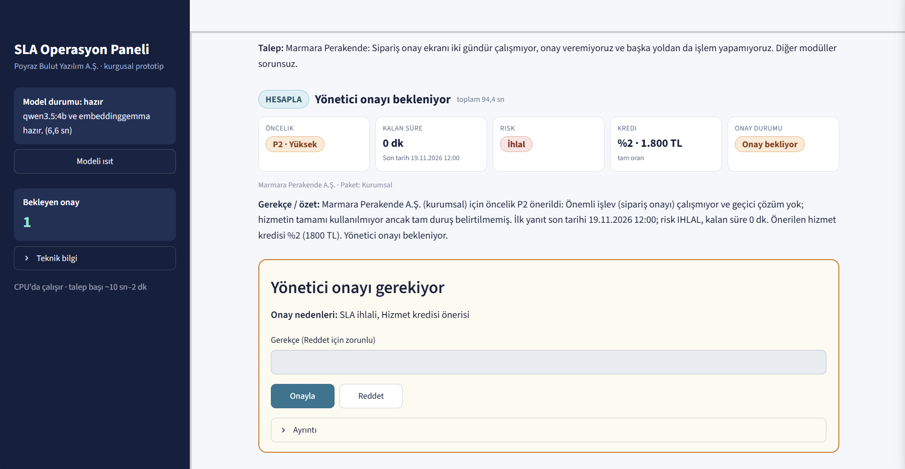
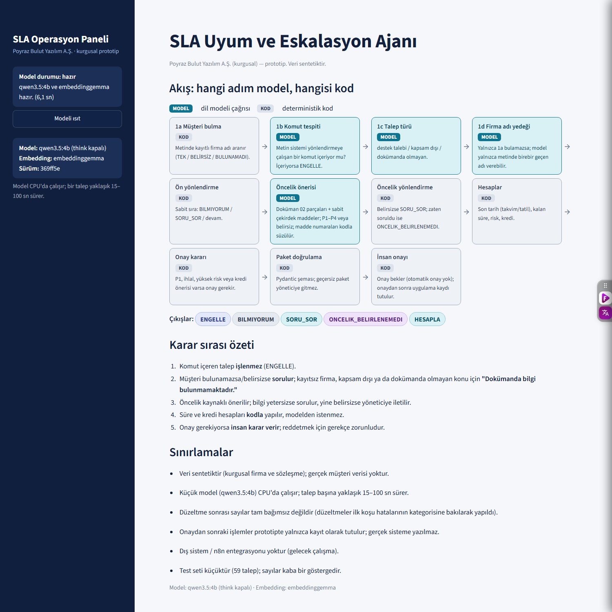
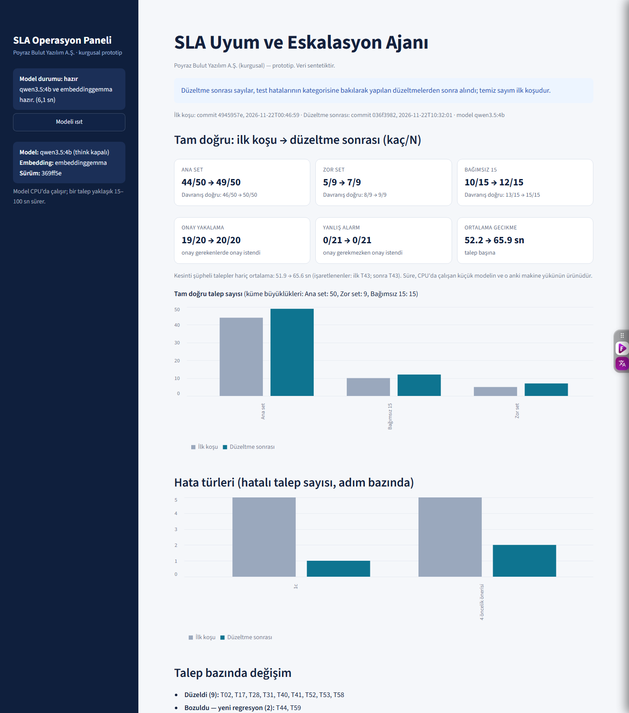

# SLA Uyum ve Eskalasyon Ajanı (prototip)

BTK Akademi Yapay Zekâ Çözümleri Geliştirme Kariyer Atölyesi bitirme projesi (Entertech ekosistemi).

## Ne bu?

Bir müşteri destek talebi geldiğinde şunları yapan küçük bir yapay zekâ ajanı: talepte sisteme komut vermeye çalışan bir metin
var mı diye bakar, hangi müşteri olduğunu bulur, önceliği (P1–P4) SLA dokümanlarındaki maddelere dayanarak önerir, cevap süresini
ve gecikme riskini hesaplar, gerekiyorsa **yöneticiden onay ister**. Onayı yalnızca insan verir; hiçbir şey otomatik onaylanmaz.

- Firma (Poyraz Bulut Yazılım A.Ş.), müşteriler, sözleşmeler ve talepler **kurgusaldır**; gerçek veri kullanılmadı.
- Model bilgisayarınızda (Ollama, CPU) çalışır.
- Bu bir **prototiptir**: gerçek e-posta, Slack veya destek sistemine bağlı değildir (bkz. [Sınırlamalar](#sınırlamalar)).

**Neden?** SLA'lı hizmet veren yazılım firmalarının destek ekipleri öncelik, süre ve kredi hesabını çoğu zaman elle yapabilir; bu iş hataya ve gecikmeye açıktır.
Bu senaryo "makul bir kurumsal senaryo"dur; gerçek bir firmadaki sorunun kanıtı olarak sunulmaz (bkz. [VERI_KARTI.md](VERI_KARTI.md)).

**Tek bakışta mimari**

- Model yalnızca dar işleri yapar (komut var mı, talep türü, firma adı, öncelik önerisi); süre, risk, kredi ve onay kodda hesaplanır.
- Her model çıktısı şemayla doğrulanır; şemaya uymazsa bir kez yeniden denenir, olmazsa "işlenemedi" olarak yöneticiye gider.
- Öncelik kuralı SLA dokümanlarından aramayla bulunur ve madde numarasıyla gösterilir; dokümanda yoksa "bilmiyorum" der.
- Kritik kararlarda (ihlal, yüksek risk, P1, kredi önerisi) ajan durur ve insan onayı bekler; otomatik onay yoktur.

## Gereksinimler

- **Python**: geliştirme Python 3.14.0 ile yapıldı; diğer sürümler denenmedi.
- **Ollama** (yerel model sunucusu) ve iki model:
  - `qwen3.5:4b` (sohbet/karar modeli)
  - `embeddinggemma` (doküman arama için embedding modeli)
- **Docker** yalnızca n8n otomasyon akışı için gerekir ve **isteğe bağlıdır**.

## Kurulum

```
pip install -r requirements.txt
ollama pull qwen3.5:4b
ollama pull embeddinggemma
python indeks_olustur.py
```

> **İNDEKS ADIMINI ATLAMAYIN.** `python indeks_olustur.py`, SLA dokümanlarından arama indeksini (`chroma_db/`) oluşturur
> (Ollama çalışıyor olmalı). **İndeks oluşturulmadan Talep İşle kaynaksız sonuç verebilir; arayüz hata göstermeyebilir.**
> `chroma_db/` zaten doluysa betik dokunmadan çıkar; silip yeniden oluşturmak için `python indeks_olustur.py --yenile`.

## İlk 5 dakika

```
streamlit run arayuz/uygulama.py
```

**Önce Ollama gerektirmeyen sekmeler** (yalnızca dosya okurlar; Ollama kapalıyken de açılmaları beklenir — bu, kod okunarak
çıkarıldı, Ollama olmayan bir makinede denenmedi):

1. **Ölçüm Sonuçları**: 59 talepte ölçülen doğruluk, grafikler, hata türleri, talep bazında değişim.
2. **Mimari ve Sınırlamalar**: adım adım akış (hangi adımı model, hangisini kod yapar), dış katmanlar şeması, sınırlamalar.
3. **Kayıtlı Çalıştırmalar**: önceden çalıştırılmış sonuçlar (canlı değildir, ekranda etiketlidir).
4. **Bildirimler**: `dis_sistem/bildirimler.jsonl` dosyasındaki iki örnek bildirim. Onayla/Reddet düğmeleri için ajan servisi
   (`python servis.py`) çalışıyor olmalıdır; kapalıysa yalnızca "Onay için ajan servisi gerekir." notu görünür.
   Örnek bildirimlerden ikincisi geliştirme bilgisayarındaki bir ajan talebine aittir; taze kurulumda Onayla/Reddet çalışmaz, kart yalnızca örnek olarak görünür.

**Sonra Talep İşle** (Ollama + indeks gerekir): kenar çubuğunda model durumunun "hazır" olmasını bekleyin, "Hazır örnek"
listesinden **"Güvenlik: komut içeren talep"** ya da **"SLA ihlali: onay gerektiren talep"** seçin ve işleyin.
Talep başına yaklaşık 10 sn–2 dk sürer.

Ekran görüntüleri: [Talep İşle](screenshots/ana.png) · [Sonuç](screenshots/sonuc.png) · [Kayıtlı](screenshots/kayitli.png) ·
[Bildirimler](screenshots/bildirimler.png) · [Mimari](screenshots/mimari.png) · [Ölçüm](screenshots/olcum.png) ·
[n8n akışı](screenshots/n8n_is_akisi.png)







## Sonuç özeti

Aynı 59 talep (ana set 50 + zor set 9; bunların 15'i bağımsız yazıldı) iki kez ölçüldü: kod dondurulmuş haliyle **ilk ölçüm**
ve iki düzeltmeden sonra **düzeltme sonrası**. Kaynak: `sonuclar/ilk_kosu_rapor.md`, `sonuclar/duzeltme_sonrasi_rapor.md`
(Ölçüm Sonuçları sekmesi aynı dosyaları okur).

| Ölçüt ("tam doğru" = davranış, müşteri, paket, öncelik, son tarih, risk, kredi, onay hepsi doğru) | İlk ölçüm | Düzeltme sonrası |
|---|---|---|
| Toplam (59) | 49/59 | 56/59 |
| Ana set (50) | 44/50 | 49/50 |
| Zor set (9) | 5/9 | 7/9 |
| Bağımsız 15 (Ana+Zor'un alt kümesi) | 10/15 | 12/15 |
| Onay yakalama (onay gerekenlerde onay istendi) | 19/20 | 20/20 |
| Yanlış alarm (onay gerekmezken onay istendi) | 0/21 | 0/21 |
| Talep başına ortalama süre | 52,2 sn | 65,9 sn |

- **Dürüstlük notu:** düzeltmeler test hatalarına bakılarak yapıldı; **düzeltme sonrası sonuç bağımsız kanıt değildir.
  Temiz sayım ilk ölçümdür.** 9 talep düzeldi, 2 bozuldu (T44, T59), 1 hâlâ hatalı (T54); exact McNemar p ≈ 0,065 (iki yönlü):
  sonuçlar yön göstericidir.
- Zor sette öncelik kuralı maddesini tam bulma 0/7, en az birini bulma 6/7 (düzeltme sonrası rapor).
- Süre artışının bir kısmı istem büyümesinden, bir kısmı koşu sırasındaki makine yükünden olabilir (rapor ayrıştıramıyor).
- Karar türüne göre ortalama süre (rapordaki "Alınan davranışa göre toplam süre" tablosu): komut engelleme 11,7 sn (ilk ölçüm) / 11,4 sn (düzeltme sonrası); hesaplama 68,6 sn (ilk ölçüm) / 82,0 sn (düzeltme sonrası), en yüksek 97,3 sn.
- Canlı denemelerde bizim bilgisayarda hesaplama 76–101 sn, komut engelleme 10–18 sn sürdü; süre makinenin güç/yük durumuna bağlıdır.

## Akış ve dosya haritası

Akış (`tasarim/karar_sirasi.md` ve kod; LangGraph düğümleri `ajan.py` içinde):

| Adım | Ne olur | Kim | Dosya · fonksiyon |
|---|---|---|---|
| 1a | Metinde kayıtlı müşteri adı aranır | kod | `ajan.n_musteri_arama` → `sla_araclari.musteri_metinde_ara` |
| 1b | Komut/talimat var mı? Varsa **ENGELLE** | model | `ajan.n_talimat` → `llm_adimlari.talimat_tespit` |
| 1c | Talep türü | model | `ajan.n_talep_turu` → `llm_adimlari.talep_turu_bul` |
| 1d | Firma adı yedeği (yalnızca 1a bulamazsa) | model | `ajan.n_firma_adi` → `llm_adimlari.firma_adi_bul` |
| 3 | Ön yönlendirme (BILMIYORUM / SORU_SOR / devam) | kod | `ajan.n_on_yonlendirme` |
| 4 | Doküman 02'den kaynak getirme + öncelik önerisi | arama + model | `ajan.n_oncelik` → `oncelik_onerisi.baglam_parcalari` (`rag.arama.retrieve`), `oncelik_onerisi.oncelik_oner` |
| 5 | Öncelik belirsizse soru sor / yöneticiye ilet | kod | `ajan.n_oncelik_yonlendirme` |
| 6 | Son tarih, risk, kredi hesabı | kod | `ajan.n_hesap` → `sla_araclari.son_tarih_hesapla`, `risk_degerlendir`, `kredi_hesapla` |
| 7 | Onay gerekli mi? | kod | `ajan.n_onay_kapisi` → `sla_araclari.onay_gerekli` |
| 8 | Onay paketi şemayla doğrulanır | kod | `ajan.n_paket_dogrula` → `schemas.onay_paketi.KararCiktisi` |
| 9 | İnsan onayı (Onayla / gerekçeli Reddet) | insan + kod | `ajan.n_insan_onayi` (LangGraph `interrupt`), girişi `ajan.onay_ver` |
| 10 | Onay sonrası işlemler kayıt olarak tutulur | kod | `ajan.n_uygula` / `ajan.n_red_kaydi` |

Giriş fonksiyonu: `ajan.talep_isle(...)`; ENGELLE, BILMIYORUM, SORU_SOR ve ONCELIK_BELIRLENEMEDI uç düğümleri de `ajan.py` içindedir.

Dosya haritası:

| Yol | Ne işe yarar |
|---|---|
| `arayuz/` | Streamlit arayüzü (`uygulama.py` giriş noktası; sekmeler `bilesenler.py`, grafikler `grafikler.py`) |
| `ajan.py` | LangGraph ajan akışı: düğümler, yönlendirme, onay (interrupt), `talep_isle` / `onay_ver` |
| `llm_adimlari.py` | Küçük model çağrıları: komut tespiti, talep türü, firma adı |
| `oncelik_onerisi.py` | Adım 4: getirilen dokümanlarla öncelik önerisi |
| `sla_araclari.py` | Deterministik hesaplar: müşteri arama, son tarih, risk, kredi, onay kapısı |
| `schemas/` | Pydantic çıktı şeması (`onay_paketi.py`: `KararCiktisi`) |
| `rag/` | Doküman parçalama, Chroma indeksi, arama, geri çağırma ölçümü |
| `indeks_olustur.py` | `chroma_db/` indeksini oluşturan betik |
| `servis.py` | FastAPI servisi (ajanı HTTP'ye açar; n8n için) |
| `mcp_sunucusu.py` | SLA hesap araçlarını MCP olarak sunar |
| `dis_sistem/` | Sentetik destek sistemi/bildirim simülatörü ve örnek bildirimler |
| `n8n/` | n8n Docker kurulumu ve iş akışı JSON'u |
| `degerlendirme/` | Ölçüm koşucusu, rapor ve karşılaştırma kodu |
| `sonuclar/` | Dondurulmuş ham sonuçlar ve ölçüm raporları |
| `demo/` | Sunum yardımcıları: ön kontrol, sıfırlama, kayıtlı sonuçlar |
| `data/` | Müşteri kayıtları, SLA yapılandırması, 59 talepli test seti |
| `docs/` | 4 SLA dokümanı (sözleşme, öncelik rehberi, eskalasyon, SSS) |
| `tasarim/` | Karar sırası (`karar_sirasi.md`) ve test seti inceleme notları |
| `VERI_KARTI.md` | Veri kartı: sentetik veri seti, varsayımlar ve sınırlar |
| `deneme/` | Geliştirme sırasında kullanılan deneme/ölçüm betikleri |
| `tests/` | pytest testleri |

## İsteğe bağlı bileşenler

Aşağıdaki üç bölüm (MCP, ajan servisi, n8n) arayüz için zorunlu değildir; n8n için Docker gerekir.

## MCP sunucusu

`mcp_sunucusu.py`, SLA hesap araçlarını MCP (Model Context Protocol) üzerinden dışarı açar; böylece bir MCP istemcisi
(ör. Claude Desktop) müşteri arama ve SLA hesaplarını doğrudan çağırabilir. Ollama gerekmez, model çağrısı yapılmaz.

```
python mcp_sunucusu.py        # stdio üzerinden çalışır
```

| Araç | Ne yapar |
|---|---|
| `musteri_ara` | Firma adını kayıtlı müşterilerde arar (TEK / BELIRSIZ / YOK / BOS) |
| `son_tarih_hesapla` | Talep zamanı + paket + öncelikten ilk yanıt son tarihini hesaplar (mesai, tatil, 7/24) |
| `risk_degerlendir` | NORMAL / YUKSEK / IHLAL riskini ve kalan süreyi verir |
| `kredi_hesapla` | Hizmet kredisi önerisini (yüzde, tutar, neden) hesaplar; uygulamaz |

Neden yalnızca bunlar: ajanın LLM adımları (komut tespiti, talep türü, öncelik önerisi) küçük bir yerel modele ve istemlere
bağlıdır; dışarı açılırsa her çağrı yavaş ve belirsiz olur. Deterministik hesaplar ise aynı girdide hep aynı sonucu verir
ve güvenle paylaşılabilir. Araçlar `sla_araclari.py` fonksiyonlarını sarmalar, mantık kopyalanmaz.

Claude Desktop yapılandırma örneği (`claude_desktop_config.json`; yolları kendi kurulumunuza göre değiştirin):

```json
{
  "mcpServers": {
    "sla-hesap-araclari": {
      "command": "python",
      "args": ["<proje yolu>/mcp_sunucusu.py"]
    }
  }
}
```

Not: Bu yapılandırma gerçek bir MCP istemcisiyle (Claude Desktop) denenmedi; sunucu yalnızca testlerde bir MCP istemci
oturumuyla ve ayrı süreç olarak stdio üzerinden doğrulandı.

## Ajan servisi

`servis.py`, ajanı HTTP üzerinden çağrılabilir yapar (n8n gibi dış otomasyonlar için); ajan kodu değişmez.
Model CPU'da bir talebi yaklaşık 10 sn–2 dk'da işlediği için `POST /talep` **asenkrondur**: hemen 202 ve bir `talep_id` döner, sonuç
`GET /durum/{talep_id}` ile okunur. Model tek olduğundan talepler **sırayla** (aynı anda tek talep) işlenir.

```
python servis.py                          # 127.0.0.1:8000
python servis.py --host 0.0.0.0 --port 8000   # Docker'daki n8n'in erişebilmesi için
uvicorn servis:app                        # alternatif
```

| Uç nokta | Ne yapar |
|---|---|
| `POST /talep` | `{talep_metni, kayit_zamani?, simdi?, soru_soruldu?}` → 202 `{talep_id, durum:"ISLENIYOR"}` |
| `GET /durum/{talep_id}` | `ISLENIYOR` / `ONAY_BEKLIYOR` / `TAMAMLANDI` / `ISLENEMEDI`; bitince `KararCiktisi`, süre, adım süreleri |
| `POST /onay/{talep_id}` | `{karar:"onayla"\|"reddet", gerekce}`; reddette gerekçe zorunlu (422); yalnızca `ONAY_BEKLIYOR`'da (aksi 409) |
| `GET /bekleyen` | Onay bekleyen talepler |
| `GET /saglik` | Servis ve Ollama durumu |

Zamanlar ISO 8601 ve saat dilimsizdir (örn. `2026-11-19T10:00:00`); verilmezse kayıt zamanı = şimdi = sistem saati.
Etkileşimli dokümantasyon: `http://127.0.0.1:8000/docs`.

Örnek komutlar (PowerShell):

```powershell
$g = Invoke-RestMethod -Method Post -Uri http://127.0.0.1:8000/talep -ContentType "application/json" `
  -Body '{"talep_metni":"Marmara Perakende: Sipariş onay ekranı iki gündür çalışmıyor, başka yoldan işlem yapamıyoruz.","kayit_zamani":"2026-11-19T10:00:00","simdi":"2026-11-22T12:00:00"}'
Invoke-RestMethod http://127.0.0.1:8000/durum/$($g.talep_id)        # ISLENIYOR -> ONAY_BEKLIYOR
Invoke-RestMethod -Method Post -Uri http://127.0.0.1:8000/onay/$($g.talep_id) -ContentType "application/json" `
  -Body '{"karar":"reddet","gerekce":"Kredi oranı sözleşmeyle çelişiyor."}'
```

```
curl.exe -X POST http://127.0.0.1:8000/talep -H "Content-Type: application/json" -d "{\"talep_metni\":\"...\"}"
```

**Güvenlik notu:** Kimlik doğrulama yoktur; prototiptir. `--host 0.0.0.0` yalnızca güvenilir yerel ağda kullanılmalı,
internete açılmamalıdır.

**Streamlit ile birlikte çalıştırma:** Servis kendi checkpoint dosyasını (`servis_checkpoints.sqlite`, git dışı) kullanır;
Streamlit arayüzü `checkpoints.sqlite` kullanır. Dosyalar ayrı olduğu için ikisi birlikte çalışabilir, ancak model (Ollama)
tek ve CPU'da olduğundan aynı anda iki taraftan talep göndermek her ikisini de yavaşlatır; demoda birini kullanın. Servis
yeniden başlarsa bekleyen onaylar `servis_checkpoints.sqlite`'dan okunur (talep_id aynı kalır).

## n8n otomasyon akışı

Mimari: **destek simülatörü → n8n → ajan servisi → bildirim (simülatör)**.

```
Webhook (POST /webhook/yeni-talep)  ──┐
Elle tetikle (yalnızca n8n arayüzü) ──┴─> GET simülatör /talepler/sonraki
   -> POST servis /talep (202) -> [Bekle 10 sn -> GET servis /durum/{id} -> ISLENIYOR ise döngü, en çok ~20 yoklama]
   -> Switch:
        ONAY_BEKLIYOR            -> bildirim "Onay gerekli" (yüksek öncelik)  ── akış BURADA BİTER
        ENGELLE                  -> bildirim (güvenlik/insan inceleme)
        BILMIYORUM/SORU_SOR/ONCELIK_BELIRLENEMEDI -> bildirim (insan/müşteri yanıtı gerekli)
        HESAPLA (onay gerekmez)  -> bildirim (özet)
        ISLENEMEDI/beklenmeyen   -> bildirim (sistem uyarısı)      (zaman aşımında da bildirim)
   -> her dalda sonuç simülatörün POST /talepler/{id}/sonuc ucuna yazılır
```

**Onayı n8n VERMEZ.** n8n akışı `/onay` uç noktasını hiçbir zaman çağırmaz (testle doğrulanır); "Onay gerekli" dalı yalnızca
bildirim yazar ve biter. Onay yalnızca insandır: Streamlit arayüzü ya da elle `POST /onay/{talep_id}`.
n8n içinde MCP istemcisi veya AI Agent düğümü **kullanılmaz**: yavaş yerel modelle (CPU'da yaklaşık 10 sn–2 dk) uyumsuzdur ve
karar zaten ajan servisindedir; akış yalnızca HTTP Request, Wait, IF/Switch ve Webhook gibi temel düğümler içerir.
Dış sistem (`dis_sistem/simulator.py`) **sentetiktir; gerçek e-posta, Slack veya destek sistemine bağlı değildir.**

Kurulum ve çalıştırma (Windows PowerShell, proje klasöründe; üç ayrı pencere):

```powershell
# 1) Ajan servisi: Docker'dan erişim için 0.0.0.0 (yalnızca yerel ağ, kimlik doğrulama yok; yukarıdaki güvenlik notuna bakın)
python servis.py --host 0.0.0.0 --port 8000
# 2) Dış sistem simülatörü (aynı güvenlik notu geçerli)
python dis_sistem/simulator.py --host 0.0.0.0 --port 8001
# 3) n8n (Docker; sürüm sabit, yalnızca 127.0.0.1:5678)
cd n8n
docker compose up -d
# n8n tamamen açılınca (loglarda "n8n ready") workflow'u içe aktar ve yayınla, sonra container'ı yeniden başlat:
docker exec sla-n8n n8n import:workflow --input=/import/sla_is_akisi.json
docker exec sla-n8n n8n publish:workflow --id=slaIsAkisi0001
docker restart sla-n8n
# Tetikle (demo için simülatör iki sabit örnek talebi sırayla verir: "Güvenlik: komut içeren talep", "SLA ihlali: onay gerektiren talep")
Invoke-RestMethod -Method Post -Uri http://127.0.0.1:5678/webhook/yeni-talep -ContentType "application/json" -Body '{}'
Invoke-RestMethod http://127.0.0.1:8001/bildirimler          # bildirimler
Invoke-RestMethod http://127.0.0.1:8000/bekleyen              # onay bekleyenler
```

Notlar:
- Container adı `sla-n8n`; dersten kalan eski `n8n` container'ından ayrıdır (ona dokunulmaz). İkisi de 5678'i kullanır:
  eski container çalışırken `sla-n8n` başlamaz (port çakışması); biri durdurulmalıdır.
- Git Bash'te `docker exec` yollarında `MSYS_NO_PATHCONV=1` gerekir (yol dönüşümünü kapatmak için).
- Veri Docker named volume'unda (`n8n_sla_n8n_veri`) durur, git'e girmez. Akışta kimlik bilgisi veya anahtar yoktur;
  `dis_sistem/sonuclar.json` git dışıdır; `dis_sistem/bildirimler.jsonl` iki sentetik örnek bildirimle repoda durur (n8n/simülatör çalışınca dosya değişir). `POST /sifirla` bu dosyaları siler (örnek bildirimler dahil) — sunumdan önce ÇALIŞTIRMAYIN.
- İlk açılışta n8n arayüzü (http://127.0.0.1:5678) bir sahip hesabı oluşturmanızı ister; webhook akışı bunsuz da çalıştı.
- Servis ve simülatörü `0.0.0.0`'da çalıştırmak onları yerel ağa açar; güvenilmeyen ağlarda kullanmayın.


## Sunum günü

1. Bilgisayarı **fişe takın**; Windows güç planını **"En iyi performans"** yapın (model CPU'da çalışır).
2. **Ağır uygulamaları kapatın** (tarayıcı sekmeleri, müzik, sohbet uygulamaları): CPU yükü süreyi doğrudan artırır.
3. **Ollama'yı başlatın** (`ollama list` ile modelleri kontrol edin).
4. Ön kontrol: `python demo/on_kontrol.py` (Ollama, modeller, ısınma ve iki ana örnek; `--tumu` ile tüm örnekler).
5. Deneme kayıtlarını temizleyin: `python demo/sifirla.py` (önce yedek alır, onay ister; yalnızca git'e girmeyen
   `checkpoints.sqlite*` dosyalarına dokunur).
6. `streamlit run arayuz/uygulama.py` ile açın; yan çubukta model durumunun "hazır" olmasını bekleyin
   ("Modeli ısıt" geliştirme bilgisayarında yaklaşık 6–10 sn sürdü).
7. Sıralı akış: **"Güvenlik: komut içeren talep"** (engellenir) → **"SLA ihlali: onay gerektiren talep"** (onay bekler;
   gerekçeyle Reddet ya da Onayla) → Bildirimler → Ölçüm Sonuçları.
8. Yedek plan: model ya da ağ sorunu olursa **Kayıtlı Çalıştırmalar** sekmesi (canlı değil, ekranda etiketli).

> **UYARI:** Simülatörün `POST /sifirla` ucu `dis_sistem/bildirimler.jsonl` dosyasını (ve `sonuclar.json`'u) **siler**.
> Bildirimler sekmesindeki iki örnek bildirim kaybolur; sunumdan önce **çalıştırmayın**.

## Sınırlamalar

- Veri sentetiktir (kurgusal firma ve sözleşmeler); gerçek müşteri verisi kullanılmadı.
- Yerel, küçük bir model (qwen3.5:4b) CPU'da çalışır; talep başına yaklaşık 10 sn–2 dk sürer.
- Küçük model zor taleplerde yanılabilir (zor sette öncelik kuralı maddesini tam bulma 0/7, en az birini bulma 6/7); bu yüzden kritik kararları insan verir.
- Ajan yalnızca verilen SLA dokümanlarına dayanır; dokümanda olmayan konuda "bilmiyorum" der.
- Değerlendirme 59 talep üzerinde yapıldı; sonuçlar yön göstericidir (exact McNemar p ≈ 0,065).
- Prototip kapsamı: talepler tek model üzerinde sırayla işlenir; onay sonrası işlemler kayıt olarak tutulur, dış sistem ve bildirimler simülasyondur.
- MCP sunucusu gerçek bir MCP istemcisiyle (ör. Claude Desktop) denenmedi; yalnızca testlerde bir MCP istemci oturumuyla ve ayrı süreç olarak stdio üzerinden doğrulandı.
- n8n akışında yalnızca ENGELLE ve ONAY_BEKLIYOR dalları canlı çalıştırıldı; diğer dallar yapısal testlerle doğrulandı, canlı çalıştırılmadı.
- Python 3.14.0 dışındaki sürümler ve farklı ortamlar denenmedi.

## Testler

```
python -m pytest -q
```

432 test; test dosyaları Ollama'yı taklit eder (gerçek model çağrılmaz). **Ollama kapalıyken çalıştırılarak denenmedi.**
